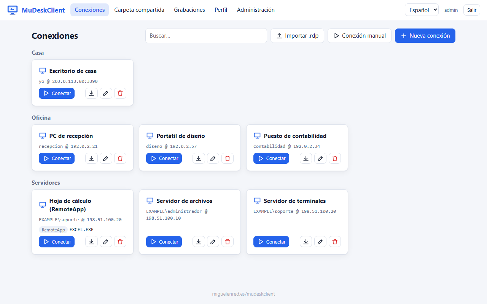
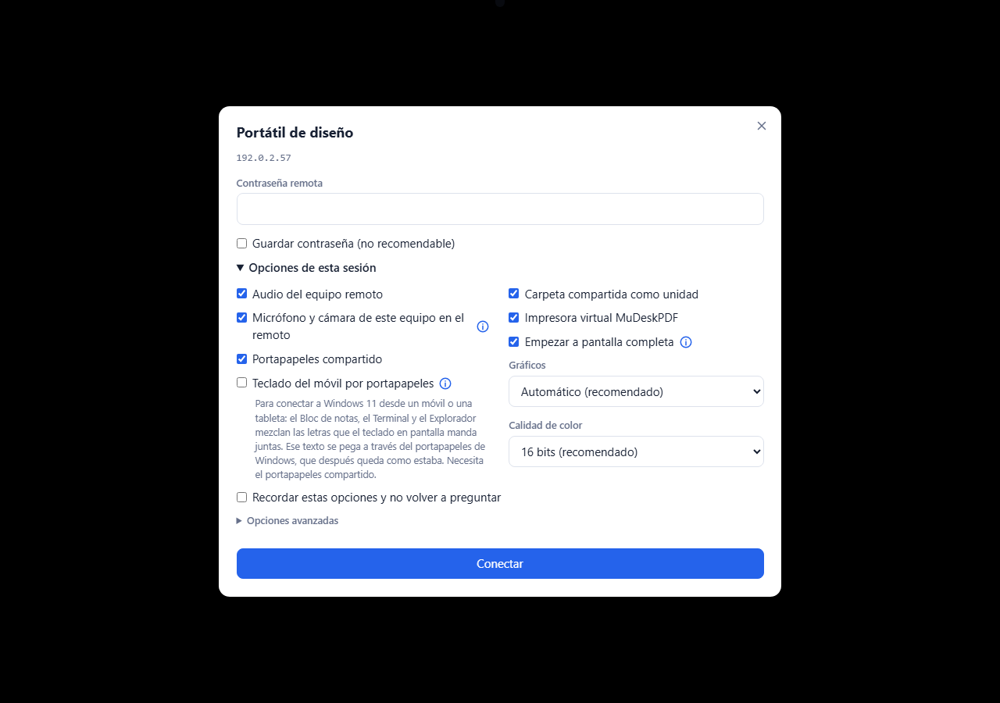
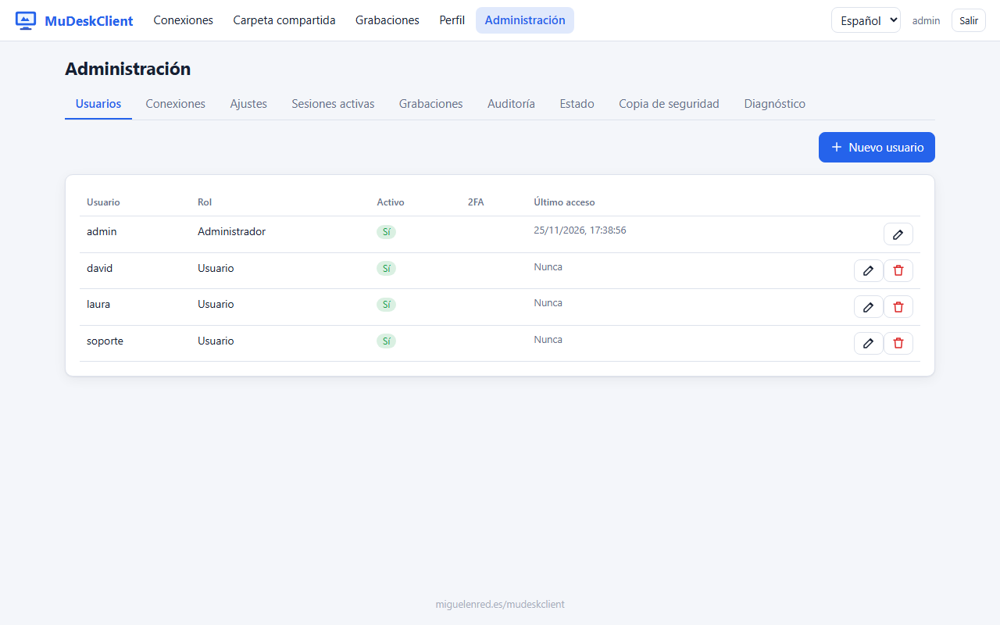
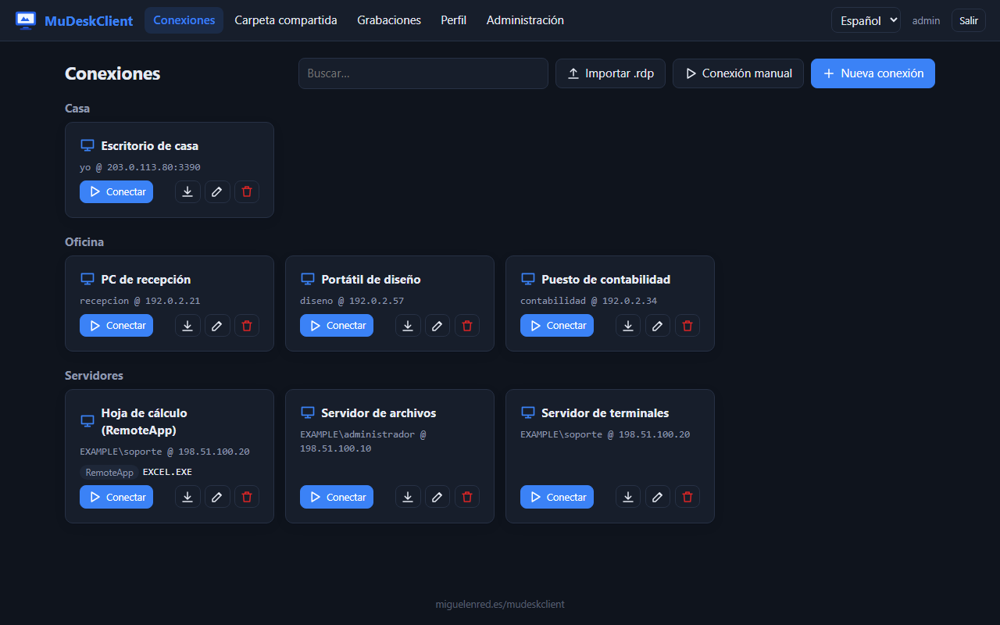

# MuDeskClient

Cliente de escritorio remoto (RDP) que funciona en el navegador. El navegador solo usa HTML, CSS y JavaScript; una pasarela escrita en PHP puro habla RDP con los equipos remotos. No hay que instalar nada en los equipos remotos ni se necesita base de datos: todo se guarda en ficheros JSON.

[Read in English](README.md)

## Capturas



| Conectar: contraseña y opciones | Administración | Modo oscuro |
|---|---|---|
|  |  |  |

Datos de demostración: nombres inventados y direcciones de documentación.

## Funciones

- Compresión RDP (MPPC, NCRUSH, XCRUSH) de extremo a extremo y órdenes de dibujo con caché de mapas de bits: los dos tramos llevan datos comprimidos.
- RDP con TLS y NLA (CredSSP con Kerberos o NTLMv2) y, para Windows XP y Server 2003, la *seguridad RDP estándar*; licencias RDS, color de 15/16/24/32 bits. Usuario como `usuario`, `DOMINIO\usuario`, `EQUIPO\usuario`, `.\usuario` (cuenta local del servidor) o `usuario@dominio` (UPN).
- Acceso: usuarios y administrador, TOTP opcional y **passkeys** (sin contraseña, o como segundo paso tras la contraseña: lo deciden el dispositivo y el navegador, y MuDesk dice cuál al añadirla), código de instalación de un solo uso, cuentas de empresa (OpenID Connect —Microsoft Entra ID, Google, Keycloak…; un usuario que ya tiene contraseña la vincula desde su perfil, ver [cómo](docs/es/USO.md#vincular-tu-cuenta-de-empresa-openid-connect)— y cuentas de Windows de Active Directory comprobadas contra un equipo RDP del dominio con NLA, sin extensiones de PHP ni LDAP; aún sin probar contra un dominio real), bloqueos por IP / usuario / sitio que nunca dejan fuera al dueño en un navegador conocido, respuestas de tiempo constante.
- Gráficos en modo **automático** (por defecto): con Windows 8.1 / Server 2012 R2 o posterior, detectado al iniciar sesión, se usa el canal gráfico; con xrdp y servidores antiguos, mapas de bits. Canal gráfico RDPGFX: vídeo AVC420 decodificado por el navegador con WebCodecs, más RemoteFX, RemoteFX progresivo, ClearCodec, planar y caché de superficie. Si el navegador no decodifica H.264, se usan los demás códecs. Con H.264 se ofrece también la versión 10.7 del canal, la única con la que Windows 10/11 usa H.264 (en las zonas animadas); los fotogramas AVC444 se muestran con su imagen 4:2:0.
- Pantalla en `<canvas>`; teclado (scancodes, cualquier distribución, teclas muertas e IME de chino, japonés o coreano, que envía el texto una vez confirmado), ratón, rueda y táctil (toque, pulsación larga = botón derecho, desplazamiento con dos dedos; o, por conexión, **multitáctil** real hacia Windows 8 y posteriores).
- La resolución remota sigue al tamaño de la ventana (canal Display Control; si el servidor no lo tiene, reconecta con el nuevo tamaño) o, por conexión, se escala la imagen a la ventana (*Escalar la imagen*). Pantalla completa con captura de teclado cuando el navegador lo permite.
- Portapapeles en los dos sentidos: texto, texto con formato (negrita, colores… en HTML, como lo copian Word y los navegadores), imágenes y archivos (descarga en ZIP si se copian varios en el remoto). Arrastrar y soltar archivos sobre la sesión: se pegan donde se sueltan (en el escritorio o en una carpeta abierta). Historial del portapapeles como Win+V: lo copiado en los dos sentidos, para pegarlo otra vez en el equipo remoto.
- Captura de pantalla del escritorio remoto, entera o de una zona marcada con el ratón, guardada en PNG o copiada al portapapeles local o al remoto.
- Impresora virtual **MuDeskPDF**: lo que se imprime en el remoto llega al navegador como PDF, listo para imprimir en cualquier impresora local o descargar.
- Audio del equipo remoto (IMA ADPCM, A-law, μ-law o PCM, reproducido con Web Audio) con botón de silencio.
- Micrófono y cámara (desmarcados de serie, una casilla de la conexión para los dos): el equipo remoto oye el micrófono de este mientras un programa graba allí, y ve su cámara (como «Cámara de MuDesk», Windows 10 1803 / Server 2019 y posteriores) mientras un programa la usa, en Chrome, Edge y Firefox, y la sesión lo dice mientras tanto (el Windows remoto tiene que permitir la redirección de grabación de audio, y no prohibir la de captura de vídeo, ver [HOSTING](docs/es/HOSTING.md#equipos-remotos); la página tiene que abrirse con `https://`).
- Ventana al conectar para elegir audio, micrófono y cámara, portapapeles, teclado del móvil por portapapeles, carpeta compartida, impresora MuDeskPDF, gráficos, calidad de color, varias pantallas y empezar a pantalla completa en cada sesión (todo se puede recordar).
- Varias pantallas: cada pantalla local con su ventana abierta es un monitor remoto independiente (no un escritorio estirado); abrir o cerrar esa ventana lo añade o lo quita sin reconectar. Chrome y Edge dan la lista de pantallas (API Window Management); Firefox busca la otra abriendo una ventana junto a esta. *Empezar a pantalla completa* (activada de serie) pone todas las pantallas a pantalla completa: con el clic en Conectar donde el navegador lo permite, y si no, con una pulsación en cada ventana.
- Barra de la sesión que se puede llevar a un lado (se queda así para las siguientes sesiones), con un indicador de calidad: imágenes por segundo, latencia de la entrada y KB/s recibidos. Su panel Archivos enumera los archivos enviados al portapapeles remoto con su estado y admite archivos soltados encima. Las ventanas de las otras pantallas tienen una barra (pantalla completa, cerrar) y se cierran con la de la sesión.
- **Compartir una sesión** con un enlace: quien lo abre ve la sesión sin cuenta (solo ver, o también usarla si el propietario le da control, que se pierde si no se usa), hasta que el propietario la cierra, revoca el enlace o se acaba su tiempo; cuántos la ven está siempre a la vista, y queda en la auditoría.
- **Estado de la administración y copias de seguridad**: sesiones, procesos, memoria, disco y problemas recientes, gráficos de los últimos 30 días, `health.php` para un monitor; una copia de seguridad cifrada de la instalación, y su restauración.
- **Grabación de sesiones**: todas las sesiones de una conexión (lo activa el administrador), o de un momento a otro con un botón de la sesión (administradores; usuarios si se permite) y desde las sesiones activas; al usuario se le avisa; la imagen y el sonido (también el del micrófono), cifrados en el servidor, guardados hasta que se eliminan a mano (o los días de un ajuste); la de la conexión la hace el servidor del flujo de la sesión, la empezada en la sesión la hace al momento el navegador del usuario, de lo que muestra (un vídeo: nada se para); las reproducen en el navegador administradores y auditores, que pueden descargarlas como vídeo WebM, y las eliminan los administradores; los usuarios ven, descargan y eliminan las que empezaron ellos, en **Grabaciones**.
- Móviles y tabletas: toque, pulsación larga = botón derecho, pellizcar para ampliar, desplazamiento con dos dedos, teclado en pantalla (se abre solo al tocar un cuadro de texto; con ratón, el botón abre un teclado en pantalla propio) y panel de teclas especiales (Esc, Tab, Ctrl/Alt/Mayús/Win que se quedan pulsadas, flechas, Inicio/Fin, RePág/AvPág, Supr, Retroceso, Intro, F1–F12).
- Carpeta compartida: la carpeta de cada usuario en el servidor web aparece en la sesión como unidad **Carpeta compartida en MuDesk** (en el idioma de la página); la web la gestiona como un explorador de archivos (árbol de carpetas, detalles o iconos con miniaturas, archivos y carpetas arrastrados desde el equipo o entre carpetas, varios elementos o carpetas descargados en un solo ZIP).
- Una carpeta de este equipo como unidad de la sesión: se elige en el panel *Archivos* de la sesión mientras dura (con la opción de la carpeta compartida) y aparece allí con su nombre; Chrome y Edge la leen y escriben, Firefox solo la lee (no puede escribir en una carpeta del equipo). Sus archivos van directamente entre el navegador y la sesión; los leídos, escritos, borrados y renombrados quedan en la auditoría.
- Usuarios con rol de administrador, verificación en dos pasos opcional (TOTP, código QR), cambio de contraseña obligatorio, bloqueo por intentos fallidos.
- Perfil: cada usuario ve sus sesiones remotas abiertas y puede cerrarlas, y sus navegadores de confianza, que puede olvidar. Al entrar se muestran los intentos fallidos con su usuario desde el último acceso, si los hubo.
- Se puede instalar como app en móviles y ordenadores (manifiesto de aplicación web e iconos, sin service worker).
- Cada usuario gestiona sus conexiones; las contraseñas remotas se cifran (AES-256-GCM) con una clave derivada de la contraseña del usuario: ni el administrador puede leerlas. Las conexiones se importan desde **archivos .rdp** de Conexión a Escritorio remoto y se exportan a ellos (nunca su contraseña), también por el administrador. Una **conexión manual** conecta una vez sin guardar nada, para las ocasionales. Una conexión puede ser una **RemoteApp**: un programa del equipo remoto, en sus propias ventanas sobre la página (también con varias pantallas), con una barra de tareas y una lista de sus ventanas. Con su dirección MAC, un equipo apagado se enciende con **Wake-on-LAN** antes de conectar (instalaciones en la propia red de los equipos). También puede ser la **consola de una máquina virtual de Hyper-V** (su pantalla a través del servidor Hyper-V, como la muestra VMConnect; aún sin probar contra un Hyper-V real). Granjas de Servicios de Escritorio remoto: a través de una **puerta de enlace de Escritorio remoto (RD Gateway)** (MS-TSGU sobre HTTPS, en PHP puro; también la de Windows Server 2008 y 2008 R2, con RPC sobre HTTP) y siguiendo la redirección de un **agente de conexión** (aún sin probar contra una puerta de enlace ni un agente reales).
- Certificados de los servidores: la primera conexión a un equipo muestra sus huellas para confirmarlas antes de enviar nada (o una que un administrador fijó para todos); se avisa si cambian.
- Administración: usuarios, conexiones para algunos usuarios o para todos (que no pueden cambiarlas ni borrarlas) y las propias de cada usuario, listas blancas (IPs de acceso y equipos remotos: IPs, rangos CIDR, nombres, `*.dominio`), límites (también de sesiones RDP a la vez de todos los usuarios), permitir o no guardar la contraseña de las conexiones RDP, sesiones activas (con cierre forzado) y auditoría detallada (accesos, cambios, sesiones RDP, portapapeles, unidad compartida, impresión) con búsqueda, exportación (CSV, o JSON firmado con una clave del servidor que cualquiera puede comprobar con `openssl`), conservación configurable (90 días por defecto, o sin límite) y detección de manipulaciones; modo diagnóstico con una traza técnica de la sesión (sin contenidos ni contraseñas).
- Interfaz en español e inglés: se usa el idioma del navegador (inglés si no es ninguno de los dos) y cada usuario puede cambiarlo con el selector de la cabecera (también en la pantalla de acceso y en el perfil), que lo guarda en su perfil; adaptable a móvil, tema claro y oscuro.

## Requisitos

- PHP 8.1 a 8.5 de 64 bits (todas probadas) solo con las extensiones OpenSSL y session que trae PHP de serie (ninguna otra extensión ni paquetes de Composer).
- HTTPS (lo exigen la API de portapapeles del navegador y las cookies de sesión).
- El servidor web debe poder mantener abierta una petición durante toda la sesión y enviar la salida sin acumularla (ver *Hosting*).
- Conexión TCP saliente desde el servidor web al puerto RDP de los equipos (3389 por defecto).
- Navegador actual (Chrome, Edge, Firefox) en ordenador, tableta o móvil. Safari no se ha probado nunca, y aquí no se puede (no hay ningún dispositivo de Apple). Varias pantallas: Chrome y Edge dan la lista; Firefox busca la otra (ver *Limitaciones*).

## Compatibilidad (RDP y RDS)

**Importante:** probado contra Windows 11 Pro 23H2 (NLA), Windows Server 2022 (Host de sesión con licencias RDS, agente de conexión, RemoteApp, Puerta de enlace de RD, Active Directory con Kerberos; ver [PRUEBAS](docs/es/PRUEBAS.md#windows-server-2022-standard-después-de-120)), Windows Server 2012 R2, 2012, 2008 R2, 2008 y 2003 (ver [PRUEBAS](docs/es/PRUEBAS.md)), xrdp 0.9.24 y el servidor FreeRDP 3; el usuario probó además RemoteApp y una cuenta del dominio (Active Directory, NTLMv2; con la versión 1.0) en un Windows Server 2016, y el sonido en Windows 10. Windows 10 y las demás versiones de Windows Server hablan el mismo RDP 10 que las probadas, Windows 8.1 y 8 el mismo RDP 8.1 y 8.0 que Server 2012 R2 y 2012, Windows 7 el mismo RDP 7.1 que Server 2008 R2 y Windows Vista el mismo RDP 6.1 que Server 2008 (con su Service Pack 1); las filas de las versiones no probadas son lo que dicen las especificaciones del protocolo.

| Servidor | Esperado | Notas |
|---|---|---|
| Windows 11, 10, 8.1 (Pro/Enterprise) | Sí (probado Windows 11 Pro) | NLA o TLS. Probado en Windows 11: teclado, ratón, cambio de tamaño sin reconectar, compresión MPPC/NCRUSH/XCRUSH, órdenes de dibujo, canal gráfico con H.264, dos monitores, portapapeles (texto, emojis y archivos), unidad MuDesk, audio, micrófono, cámara (simulada), una carpeta de este equipo. Los gráficos H.264 necesitan Windows 8.1 o posterior. |
| Windows Server 2025, 2022, 2019, 2016, 2012 R2 (Escritorio remoto para administración o Host de sesión de RD) | Sí (probados Windows Server 2022 y 2012 R2) | Host de sesión con licencias RDS (mejor en modo por usuario, ver abajo). Sin sonido ni micrófono hasta activar su servicio Audio de Windows (ver [HOSTING](docs/es/HOSTING.md#equipos-remotos)). Sin la actualización de CredSSP de mayo de 2018 (2012 R2 tal como salió), NLA necesita `credssp_unpatched`; sin impresora MuDeskPDF antes de 2016. |
| Windows 8, Server 2012 | Sí (probado Windows Server 2012) | Gráficos en *Automático*: órdenes de dibujo y mapas de bits (el canal gráfico 8.0, sin H.264, si se elige a mano); el cambio de tamaño reconecta. Sin la actualización de CredSSP de mayo de 2018 (tal como salió), NLA necesita `credssp_unpatched`; sin impresora MuDeskPDF. |
| Windows 7, Server 2008 R2 | Sí (probado Windows Server 2008 R2) | Solo TLS 1.0 salvo que tengan la actualización de TLS 1.2 (tal como salieron, tampoco renegociación segura: el TLS 1.0 propio de MuDeskClient llega a ellos); sin la actualización de CredSSP de mayo de 2018, NLA necesita `credssp_unpatched` (ver abajo). Sin canal gráfico, cambio de tamaño sin reconectar ni impresora MuDeskPDF; en Server 2008 R2 el sonido necesita iniciar Audio de Windows y permitir la *Reproducción de audio y vídeo* (para las conexiones hechas después). La puerta de enlace de RD de Server 2008 R2 (RPC sobre HTTP) se puede usar, con NTLM. |
| Windows Vista, Server 2008 | Sí (probado Windows Server 2008) | Igual que el anterior (probado con sus dos opciones de Escritorio remoto), con un solo monitor; Server 2008 da 16 bits como mucho si no se cambia. |
| Windows XP, Server 2003 | Sí (probado Windows Server 2003) | *Seguridad RDP estándar* (RC4 de 40, 56 o 128 bits, o triple DES FIPS), con la seguridad de la conexión en *Automática* (probada en Server 2003, y contra xrdp y el servidor FreeRDP). Sin NLA, portapapeles con archivos ni impresora MuDeskPDF; 24 bits como mucho (Server 2003 lo limita a 16 si no se cambia); su sonido necesita permitir la *Asignación de audio* en la Configuración de Terminal Services (para las sesiones iniciadas después). Ver [SECURITY](SECURITY.md). |
| xrdp 0.9 o posterior | Sí (probado) | TLS; sin NLA. |
| Servidor FreeRDP 3 | Sí (probado) | TLS/NLA, canal gráfico con H.264. |

- **Protocolo:** núcleo RDP con versión de cliente 0x00080004 (RDP 5.0–8.1) sobre TLS 1.0–1.3, NLA (CredSSP v6, o la versión anterior con la que conteste el servidor, como la 3 de Windows 7; con Kerberos (AES o RC4) o NTLMv2) o la *seguridad RDP estándar* (RC4 de 40, 56 o 128 bits, o triple DES FIPS; solo con la seguridad *Automática*; un servidor que no cifra nada se rechaza); RDSTLS tras la redirección de un agente de conexión con una contraseña cifrada para su servidor. No admitido: tarjetas inteligentes (un navegador no puede dejar que la pasarela use la clave privada de la tarjeta).
- **RDS:** se admite el intercambio de licencias (solicitud, desafío, licencia nueva o renovada); las licencias no se guardan, así que usa el modo de CAL **por usuario** (el modo por dispositivo está sin probar y puede dar una licencia temporal nueva en cada conexión). **Puerta de enlace de RD (RD Gateway)**: el transporte HTTP sobre WebSocket (Windows Server 2016 y posteriores) o sobre dos conexiones HTTPS (2012, 2012 R2), entrando con Kerberos o NTLM (con el enlace de canal), y RPC sobre HTTP (2008, 2008 R2; solo NTLM); no el canal lateral UDP. **Agente de conexión**: la información de equilibrio de carga como token de enrutamiento, y sus redirecciones seguidas (Server Redirection PDU, como mucho 3; una contraseña que cifró para su servidor se entrega allí con RDSTLS). Ninguno probado aún contra uno real. No admitido: el canal gráfico en los programas **RemoteApp** (usan mapas de bits y órdenes de dibujo).
- **Funciones según la versión del servidor** (según especificación): varios monitores, Windows 7/2008 R2 o posterior; portapapeles con archivos, Vista/2008 o posterior; cambio de tamaño dinámico (Display Control), 8.1/2012 R2 o posterior (en los anteriores reconecta con el nuevo tamaño); canal gráfico, 8/2012 o posterior, H.264 (AVC420) 8.1/2012 R2 o posterior (según especificación: Windows solo usa H.264 con el canal gráfico versión 10, Windows 10 / Server 2016 o posterior; Server 2012 R2 y Windows 11 eligieron la 8.0 si se les ofrecía la 8.1); la impresora MuDeskPDF usa el controlador *Microsoft Print To PDF*, presente en Windows 10/Server 2016 o posterior; compresión MPPC en todas las versiones y XCRUSH (RDP 6.1) en Vista SP1/2008 o posterior; cámara (MS-RDPECAM), Windows 10 1803/Server 2019 o posterior.

## Instalación

Paso a paso para todos los niveles (un hosting, un PC con Windows y XAMPP o un equipo con Linux y Apache, cortafuegos y problemas frecuentes): **[manual de instalación](docs/es/INSTALACION.md)**. En resumen:

1. Copia el proyecto (o, con Composer, `composer create-project miguelenred/mudeskclient mudesk`: sin dependencias, solo PHP 8.1–8.5 con OpenSSL). Valen dos formas (detalle en [HOSTING](docs/es/HOSTING.md)):
   - **Todo el proyecto dentro de la raíz web** (`public_html/mudesk/`): los `.htaccess` (Apache, LiteSpeed) y `web.config` (IIS) incluidos dejan accesible solo `public/`; Nginx y OpenLiteSpeed necesitan las reglas de [HOSTING](docs/es/HOSTING.md) y niegan `data/`, `src/`, `tests/`, `tools/` y `docs/`. Comprueba que `mudesk/data/web-check.txt` responde 403 (o 404), nunca 200.
   - **Solo `public/` en la raíz web** y el resto fuera; si `public_html` no está dentro de la carpeta del proyecto, cambia la línea `require` del principio de `public_html/*.php` para que apunte a `src/bootstrap.php`.
2. Permisos de escritura: **solo `data/`** (y todo lo que hay dentro) necesita escritura para el usuario con el que corre PHP; la aplicación crea sus subcarpetas (`audit/`, `connections/`, `files/`, `recordings/`, `run/`, `sessions/`, `tmp/`, `trace/`). El resto (`public/`, `src/`, `config.php`) basta con lectura. Si `data/` no tiene escritura, la aplicación lo explica en una página propia, sin mensajes de PHP; en Windows (XAMPP, IIS) hay que dar el permiso *Modificar* a la cuenta del servidor web (ver [HOSTING](docs/es/HOSTING.md#permisos-de-escritura)). Fuera del proyecto solo la carpeta temporal de PHP (`upload_tmp_dir` en php.ini, o la del sistema) necesita escritura, y ya la tiene en los hostings, en XAMPP y en Linux: PHP guarda allí lo que se envía al servidor de más de 16 KB (archivos que se suben, pegados largos) mientras llega.
3. Opcional: copia `config.sample.php` como `config.php` (en la carpeta del proyecto) y ajústalo.
4. Abre la web: la primera visita pide el **código de instalación**, que está en `data/setup-code.php` (ábrelo con el administrador de archivos del hosting), y crea la cuenta de administrador. El código solo sirve una vez, y durante un día (después se escribe otro).

**Para probarlo con Docker**, un solo comando: `docker run -d --name mudesk -p 8443:443 -v mudesk-data:/var/www/mudesk/data ghcr.io/miguelenred/mudeskclient`, y abre `https://localhost:8443`; o, en la carpeta del proyecto, `docker compose up -d` con su `compose.yaml` (detalles en el [manual de instalación](docs/es/INSTALACION.md#12-opción-d-docker-para-probarlo-o-en-un-servidor-con-docker)). También un chart de Helm para Kubernetes y un contenedor LXC para Proxmox VE con un solo comando ([apartados 13 y 14](docs/es/INSTALACION.md#13-opción-e-kubernetes-helm)).

### Hosting

Cada sesión abierta mantiene una petición PHP en marcha por la que se envía la pantalla. La primera ejecución comprueba el servidor paso a paso antes de crear el administrador (PHP, la carpeta de datos, HTTPS, una petición larga, las peticiones PHP a la vez, un equipo remoto si lo pides), cada comprobación con lo que hay que hacer cuando no está bien. Para comprobar un hosting antes de instalar, sube `tools/check.php`, pon su token y ejecuta sus seis pruebas (entorno PHP, conexión RDP saliente, petición larga, latencia, carpeta de datos accesible desde la web y procesos PHP a la vez). Bórralo después.

- Apache: `public/.htaccess` desactiva la compresión del flujo y hace revalidar scripts y estilos en cada carga (IIS: `public/web.config`), para que una actualización llegue enseguida al navegador. Con PHP-FPM tras `mod_proxy_fcgi`, añade `flushpackets=on` a la configuración del proxy.
- Nginx: desactiva el búfer para `rdp.php` (`fastcgi_buffering off;`; la pasarela envía también `X-Accel-Buffering: no`) y añade `location ~* \.(js|css)$ { add_header Cache-Control "no-cache"; }`: la página pide su script y su hoja de estilos con una huella de sus archivos (`?v=`), pero los módulos que importan no la llevan. Una página abierta durante una actualización lo dice y ofrece recargar.
- Proxies como Cloudflare cortan las peticiones largas (≈100 s); el cliente reconecta solo y la sesión de Windows sigue viva, pero se recomienda conexión directa.
- Si el hosting no permite sockets Unix locales, pon `'ipc' => 'file'` en `config.php`.
- Activa OPcache (la caché de código de PHP): cada petición corta del teclado, del ratón y de las confirmaciones de fotogramas le cuesta entonces a PHP unos 5 ms en vez de 15 (medido en Windows con el servidor integrado de PHP).
- Cada sesión abierta cuenta como un proceso PHP, más uno por invitado que vea una sesión compartida, más hasta cuatro peticiones cortas a la vez mientras se escribe o se mueve el ratón (o mientras un programa remoto graba del micrófono), y hasta dos más mientras uno usa la cámara o la carpeta de este equipo, o la sesión se graba en el navegador; revisa el límite de procesos del hosting y deja *Sesiones RDP a la vez (todos los usuarios)* (`max_sessions_total`, 20 por defecto) por debajo. Al llegar a ese límite, la pasarela dice que el servidor está ocupado, sin conectar.
- En un servidor propio (Linux: un VPS, la imagen de Docker, el instalador para Debian y Ubuntu) un servicio WebSocket opcional propio de MuDeskClient lleva el flujo y el teclado y el ratón: menos retraso con ellos, ninguna petición corta mientras se escribe (menos procesos) y menos CPU. La página lo prueba y solo lo usa si responde, así que sin él todo funciona como siempre ([HOSTING](docs/es/HOSTING.md#websocket-opcional)).

### Seguridad

- Abre el puerto RDP de los equipos remotos solo a la IP del servidor web.
- Usa NLA en los equipos remotos (viene activado en las versiones actuales de Windows).
- Se aceptan certificados autofirmados en los servidores: la primera conexión a un equipo muestra sus huellas para compararlas antes de enviar nada, guarda la que se confirma y avisa si cambia después. Las conexiones nuevas vienen con la seguridad *Solo NLA*: mantenla, y que un administrador fije las huellas de los equipos habituales (ver *Known limits* en [SECURITY](SECURITY.md)).
- `data/` contiene los usuarios, los secretos cifrados y `secret.php` (clave del servidor); haz copias de seguridad. Puede quedarse dentro de la raíz web: los `.htaccess` niegan todas las carpetas salvo `public/` y, si el servidor no los aplica, nada funciona hasta que los aplique (cada página lo dice; ver [HOSTING](docs/es/HOSTING.md)).

## Configuración (`config.php`)

| Clave | Por defecto | Significado |
|---|---|---|
| `data_dir` | `<proyecto>/data` | Carpeta de ficheros JSON, sesiones y carpetas compartidas |
| `force_https` | `true` | Rechaza HTTP sin cifrar (localhost siempre se permite, salvo que sea un proxy de confianza) |
| `confirm_new_certificates` | `true` | La primera conexión a un equipo (o puerta de enlace) nunca visto muestra sus huellas para que el usuario las confirme antes de enviar nada; `false` lo acepta al momento, como antes de la 1.2 |
| `credssp_unpatched` | `false` | Se rechaza NLA con un equipo cuyo CredSSP no tiene la actualización de mayo de 2018 (Windows 7 o Server 2008 R2 sin actualizar), como hace Windows (CVE-2018-0886); `true` lo permite, solo mientras ese equipo no se pueda actualizar |
| `trusted_proxies` | `[]` | IPs de proxies inversos de los que se aceptan `X-Forwarded-For` / `X-Forwarded-Proto`: solo las direcciones exactas de tus proxies, nunca un rango (algo que no sea una dirección IP detiene el sitio con una página que lo dice) |
| `public_url` | ninguna | La dirección pública del sitio (donde está `index.php`, por ejemplo `https://rdp.ejemplo.com/mudesk`): el inicio de sesión con OpenID Connect y las llaves de acceso la usan en vez de la cabecera `Host` de cada petición (detrás de un proxy que no pasa el nombre público) |
| `ipc` | `auto` | Cómo se llega a las sesiones en marcha: `auto` (un socket Unix; en Windows un puerto TCP de este equipo; el fichero de cola si no se puede abrir ninguno) o `file` (siempre el fichero de cola) |
| `drawing_orders` | `true` | Permite que el servidor envíe órdenes de copiar/rellenar, texto con glifos en caché y use la caché de mapas de bits en vez de reenviarlos (≈3 veces menos tráfico en la prueba con xrdp; con Windows 11, mover ventanas pasa de 150 a 60 KB/s y la CPU de PHP del 6,5 al 2,7 %). Validado con xrdp y Windows 11: imagen idéntica y sin restos al repintar |
| `bulk_compression` | `'rdp61'` | Compresión RDP más alta que se ofrece: `'rdp61'` (XCRUSH, Windows Vista SP1/2008 o posterior; los servidores que solo conocen MPPC, como xrdp, usan MPPC), `'rdp6'` (NCRUSH), `'mppc'` o `false`. Por los dos tramos viajan datos comprimidos: con MPPC ≈3,5 veces menos tráfico, con XCRUSH en torno a un tercio menos que MPPC y menos CPU en la pasarela (ver ARQUITECTURA). |
| `kerberos` | `true` | Kerberos antes que NTLM (NLA y la puerta de enlace de Escritorio remoto); `false`: solo NTLM |
| `kerberos_kdc` | `[]` | Controladores de dominio por reino, cuando el DNS no los da: `['EMPRESA.LOCAL' => ['dc1.empresa.local', 'dc2.empresa.local:88']]` |
| `kerberos_dns` | `true` | Buscarlos en el DNS (registros SRV `_kerberos._tcp`); `false`: solo los de `kerberos_kdc` |
| `record_max_mb` | `2048` | Tamaño máximo de una grabación de sesión, en MB; pasado ese tamaño el resto de la sesión no se guarda (la grabación lo dice) |
| `websocket` | `true` | La página prueba el servicio WebSocket opcional (Linux, [HOSTING](docs/es/HOSTING.md#websocket-opcional)); `false`: no se prueba nunca, y el servicio termina en el acto |
| `websocket_listen` | `'127.0.0.1:8091'` | Dónde escucha ese servicio: el destino de la regla de proxy del servidor web para `<public>/ws` |

El resto de ajustes (listas blancas, bloqueo, tiempos, límites de sesiones, reintentos de conexión, cuotas, política de 2FA, conservación de la auditoría, días que se guardan las grabaciones, usuarios que graban sus sesiones, modo diagnóstico en todas las sesiones, guardar contraseñas RDP) los cambia el administrador desde la web.

## Limitaciones

- Canal gráfico (RDPGFX): lo elige el modo automático con Windows 8.1 o posterior (también se puede forzar o desactivar por conexión; nunca se usa con RemoteApp). Probado contra FreeRDP y Windows 11 (ClearCodec, RemoteFX progresivo con pasadas de mejora y AVC420). AVC444 se muestra solo con su imagen 4:2:0 (el color a resolución completa aún no). Sin ella se usan las actualizaciones de mapa de bits clásicas, que admiten todas las versiones de Windows.
- Al escribir desde el móvil por portapapeles, lo copiado en Windows se repone salvo los formatos que Windows no entrega por RDP (objetos OLE incrustados de Office); si el texto no se puede pegar (archivos copiados en Windows, o más de 16 MB), se escriben como mucho 2000 caracteres.
- Órdenes de dibujo: Mem3Blt se negocia y se dibuja con su pincel (comprobado contra el protocolo, aún no visto llegar de un servidor real: con el canal gráfico, como lo usan Windows 10 y 11, no se envían órdenes de dibujo); si llega un MemBlt cuyo modo de mezcla use pincel, se toma el pincel blanco por defecto de Windows.
- El canal gráfico limita sus superficies a 4 veces la salida gráfica en total (como mínimo 1920×1080; la salida, como mucho los píxeles de 8192 × 8192, 32766 por lado): un servidor RDP hostil aún puede hacer que el navegador guarde hasta 1 GB más o menos; por encima, el navegador falla con un error registrado.
- **RemoteApp**: el equipo remoto debe permitir el programa (Windows Server: publicado con Servicios de Escritorio remoto; Windows 10/11 Pro: en la clave del registro `TSAppAllowList`, ver [HOSTING](docs/es/HOSTING.md#equipos-remotos)). Se dibuja con mapas de bits y órdenes de dibujo (sin canal gráfico ni H.264; no se ofrece la opción Gráficos); sin iconos en el panel Ventanas ni área de notificación. Mientras se abre, un indicador lo dice (a los 15 s, que tarda más de lo normal); si el servidor cierra la sesión entretanto (error info 0x0B), la página se vuelve a conectar sola; sin ventana a los 90 s, la sesión termina diciéndolo. Al cerrar su última ventana, la sesión termina 3 s después.
- Teclados de móvil en Windows 11: el Bloc de notas, el Terminal y el Explorador estropean el texto que llega del teclado en pantalla (repiten letras, pierden mayúsculas o un Intro). Es un fallo de Windows, no de MuDeskClient; detalle y pruebas en [Teclado del móvil y Windows 11](docs/es/TECLADO-MOVIL.md). La opción «Teclado del móvil por portapapeles» (por conexión; en «Automático» se activa sola en móviles y tabletas) pega ese texto a través del portapapeles remoto y después lo deja como estaba, también una imagen copiada en Windows; si en Windows se habían copiado archivos, el texto se escribe en vez de pegarse. Un Intro seguido sin pausa de más texto aún puede perderse en el Bloc de notas; al ritmo real de un móvil pasó en 2 de 24 líneas. El teclado físico no se ve afectado.
- Las impresoras locales se usan a través de la impresora MuDeskPDF y el diálogo de impresión del navegador (el navegador no puede ver las impresoras directamente). Sin tarjetas inteligentes. El micrófono va en PCM de 16 bits (el único formato que ofrece Windows 11 aparte de los comprimidos: unos 176 KB/s de subida mientras un programa graba); la cámara en imágenes JPEG (150–185 KB/s de subida a 640 × 480 medidos con una cámara simulada; una real, unos 0,5–1,5 MB/s según una estimación, mientras un programa la usa).
- Kerberos y NTLM. Los usuarios de Active Directory entran con Kerberos (como Windows) cuando este servidor llega a un controlador de dominio (lo encuentra en el DNS, o se indica en `config.php`) y el dominio se conoce por su nombre DNS: el dominio `empresa.local`, `usuario@empresa.local`, o el equipo por su nombre completo; si no, con NTLMv2 (`DOMINIO\usuario`, o un equipo por su dirección, como el equipo al que un agente de conexión envía la sesión sin puerta de enlace). Kerberos usa AES; RC4, para un dominio de Windows Server 2003 o una cuenta cuya contraseña es anterior a las claves AES de su dominio, solo si el administrador lo permite (*Administración → Ajustes*, desactivado de serie: ver [SECURITY](SECURITY.md); sin ello esas cuentas entran con NTLM); un usuario@dominio cuyo sufijo no es el de su dominio (un sufijo UPN alternativo) se busca a través del KDC del dominio o del equipo, que dice qué dominio lo tiene. En un servidor de otro dominio del bosque, o en uno que rechaza el ticket, se entra con NTLM; el inicio de sesión con los controladores de dominio tiene 8 s en total (después, NTLM). Solo contraseñas: sin tarjetas inteligentes. Donde el dominio bloquea NTLM, o para los miembros de *Usuarios protegidos*, hace falta Kerberos. Las cuentas del dominio con NTLMv2 (`DOMINIO\usuario`) las probó el usuario en un Windows Server 2016 de un dominio, con la versión 1.0; Kerberos se probó contra un controlador de dominio Windows Server 2022 (ver [PRUEBAS](docs/es/PRUEBAS.md)) y un reino de prueba de MIT Kerberos.
- El navegador no puede poner archivos en el portapapeles local: los archivos copiados en el remoto se ofrecen como descarga.
- Leer el portapapeles local de forma automática solo es posible en navegadores basados en Chromium tras dar permiso; en el resto se usa Ctrl+V o el panel Portapapeles.
- Varias pantallas: Chrome y Edge dan la lista de pantallas (API Window Management). Firefox y Safari (nunca probado) no: la otra pantalla se busca abriendo una ventana junto a la actual (hay que permitir las ventanas emergentes), y se usan dos; si está a la izquierda de la principal, la primera vez hay que llevar esa ventana a ella (ver [USO](docs/es/USO.md#firefox-y-safari)).

## Estructura

```
public/            raíz web: index.php (interfaz), api.php, rdp.php (pasarela), files.php, oidc.php, backup.php, health.php, assets/
src/               clases PHP (sin dependencias)
src/Rdp/           protocolo RDP: Client, Transport, CredSsp, Ntlm, Kerberos, RdpSecurity (XP, 2003), Gateway y GatewayRpc (RD Gateway), Licensing,
                   Cliprdr, Rdpdr, Rdpsnd, Drdynvc, Audin (micrófono), Rdpecam (cámara), Rail (RemoteApp), Rdpei (multitáctil), Redirection (agente de conexión),
                   Bulk/Mppc/Ncrush/Xcrush (compresión), Trace (diagnóstico)
public/assets/     navegador: rdpgfx.js (canal gráfico), rfx.js (RemoteFX), gfxsurfaces.js, gfx.js, session.js, rdpfile.js (archivos .rdp),
                   mic.js y mic-worklet.js (micrófono), camera.js y tick-worker.js (cámara), localdrive.js (la carpeta de este equipo),
                   screen-watch.js (las ventanas de las otras pantallas)…
data/              almacenamiento JSON (se crea al usarse)
tools/check.php    diagnóstico del hosting
tools/ws-server.php el servicio WebSocket opcional (Linux): cada sesión una copia de él (pcntl), o tools/ws-session.php
Dockerfile, docker/ la imagen de Docker (Apache, PHP 8.4, HTTPS); compose.yaml, para arrancarla con Docker Compose
deploy/            el chart de Helm para Kubernetes (helm/), el instalador para Debian y Ubuntu (lxc/), el contenedor LXC de Proxmox VE (proxmox/)
docs/              manuales (docs/es/: en español) y las capturas de esta página (docs/images/es/)
tests/             pruebas unitarias y de extremo a extremo
```

## Rendimiento

La pantalla se lee y decodifica en un Web Worker, así la entrada nunca espera al dibujado. Teclado y ratón se envían al momento (hasta cuatro peticiones en paralelo que el servidor reordena por número de secuencia; una que el hosting rechaza se envía de nuevo) por un punto de entrada ligero que no abre la sesión PHP, y el socket RDP usa `TCP_NODELAY`. Medido: la pasarela usó 0,19 s de CPU y 4 MB de memoria para pasar 34 MB de cambios a pantalla completa en 14 s; con 60 ms de latencia de red, la última tecla de una escritura rápida llega una ida y vuelta (≈65 ms) después de pulsarla.

Compresión y caché de mapas de bits, contra xrdp con los mismos 20 s de texto desplazándose e imágenes cambiando (16 bits): 10,9 MB con mapas de bits, 3,2 MB comprimido, 3,9 MB con órdenes de dibujo y caché y **1,6 MB con las dos cosas** (6,8 veces menos); CPU de la pasarela 0,07 s, 0,50 s, 0,04 s y 0,30 s. La imagen sigue idéntica píxel a píxel en Chrome y Firefox.

Contra Windows 11 (detalle por códec y calidad, separando PHP y navegador, en [RENDIMIENTO](docs/es/RENDIMIENTO.md)): con el canal gráfico PHP gasta un 0,4–2 % de un núcleo por conexión, frente al 6–52 % con mapas de bits comprimidos; mover una ventana cuesta 35 KB/s con el canal gráfico, 60 KB/s con mapas de bits y órdenes de dibujo y 150 KB/s solo con mapas de bits. Para dimensionar un servidor según las sesiones que necesites a la vez (memoria, CPU, procesos) y subir sus límites, ver [HOSTING](docs/es/HOSTING.md#calcular-lo-que-necesitas).

Con gráficos H.264, contra un servidor FreeRDP y la misma pantalla animada: 21 KB/s frente a 4,2 MB/s con mapas de bits a 32 bits (≈200 veces menos tráfico); calidad 33 dB PSNR en Chrome y Firefox. El navegador confirma cada fotograma decodificado (solo el último pendiente), así el servidor adapta los fotogramas por segundo a lo que el equipo puede dibujar.

La revisión de velocidad de la 1.1 hizo la descompresión de la pasarela de 1,2 a 2,5 veces más rápida (MPPC, NCRUSH, XCRUSH) y su RC4 de 1,35 a 1,86 veces; los decodificadores del navegador tardan de un 9 a un 54 % menos, con los mismos píxeles; en un equipo lento (Edge limitado a la sexta parte de la CPU) una animación pasa de 9,7 a 12,3 fotogramas por segundo ([RENDIMIENTO](docs/es/RENDIMIENTO.md#cuarta-revisión-11-decodificadores-entrega-a-la-página-y-equipos-lentos)).

## Pruebas

- `php tests/run.php`: vectores de prueba de protocolo (NTLMv2, RC4, DER, TOTP, CIDR, UTF-16, Kerberos), auditoría, portapapeles, páginas de error, gestor de archivos (mover, árbol, ZIP), caducidad de la sesión web, RemoteApp (RAIL), los canales del micrófono y de la cámara, una carpeta de este equipo, el carril sin orden, conexiones del administrador, la huella de los archivos de la página, compartir y grabar sesiones; la seguridad RDP estándar, NLA con Kerberos, la puerta de enlace de RD (sus tres transportes) y el agente de conexión contra servidores de prueba escritos según las especificaciones (`tests/fixtures/`).
- `php tests/auth_e2e.php base carpetaDatos`: seguridad del inicio de sesión contra una copia en marcha con la carpeta de datos vacía.
- `php tests/rdp_probe.php equipo puerto usuario contraseña`: conecta desde la línea de órdenes e informa de lo que recibiría el navegador.
- `node tests/bench.mjs equipo puerto usuario contraseña [carga] [segundos]`: mide una conexión con una carga (reposo, texto, mover ventana, animación, sonido): tráfico, CPU y memoria de PHP, CPU y memoria de los decodificadores del navegador y fotogramas por segundo (ver [Rendimiento](docs/es/RENDIMIENTO.md)).
- `node tests/input_unit.mjs`: texto tecleado (de carácter en carácter) y cursor de texto que abre el teclado del móvil.
- `node tests/clipboard_unit.mjs`: texto con formato (CF_HTML) para el portapapeles.
- `node tests/rdpfile_unit.mjs`: archivos .rdp de Conexión a Escritorio remoto: leídos como conexión y escritos desde una.
- `node tests/mic_unit.mjs`: el micrófono en el navegador: remuestreo y PCM de 16 bits, su captura y cuándo se suelta.
- `node tests/camera_unit.mjs`: la cámara en el navegador: si hay una, el tamaño y la frecuencia pedidos, cada imagen un JPEG, los rechazos y cuándo se suelta.
- `node tests/localdrive_unit.mjs`: una carpeta de este equipo: las peticiones del servidor respondidas con File System Access (lectura y escritura) y con los archivos de una carpeta (solo lectura).
- `tests/gfx_unit.mjs`, `tests/rdpgfx_unit.mjs` (ZGFX, ClearCodec, NSCodec, RemoteFX, progresivo, SPS H.264), `tests/bulk_unit.mjs` (MPPC, NCRUSH, XCRUSH, fragmentos), `tests/orders_unit.mjs` (también órdenes de ventana), `tests/audio_codecs.mjs` (requiere sox): pruebas unitarias de decodificadores (Node.js).
- `node tests/session_unit.mjs` (entrada, reconexión, órdenes de dibujo, worker del flujo, varias pantallas, RemoteApp, la cámara y la carpeta de este equipo por el carril sin orden), `node tests/ui_unit.mjs` (perfil, auditoría, ventana de sesión, descargas ZIP, captura, explorador de archivos, sesión caducada, archivos .rdp, conexiones del administrador, RemoteApp, panel Archivos, barra movible, aviso de actualización, las ventanas de las otras pantallas): código del navegador sobre dobles mínimos.
- `php tests/fuzz.php`, `node tests/fuzz.mjs`: datos aleatorios y mutados contra la pasarela (núcleo RDP y canales, también RemoteApp, el micrófono y la cámara, la carpeta de este equipo, la seguridad RDP estándar, Kerberos y el transporte RPC de la puerta de enlace de RD) y los decodificadores del navegador; semilla fija, opciones `--seed`, `--iterations`, `--target`, `--case` y `--strict`.
- `tests/gfx_render.mjs`, `tests/audio_check.mjs`: decodifican los volcados de `rdp_probe.php` (`DUMP=fichero`, `AUDIO=1`).
- `tests/e2e.mjs`, `tests/e2e_clip.mjs`, `tests/e2e_gfx.mjs` (H.264: compara el canvas con una captura del remoto), `tests/e2e_passkey.mjs`, `tests/e2e_lang.mjs`, `tests/e2e_glyphs.mjs`: pruebas en Chrome (Node.js + Playwright); `tests/e2e_firefox.py`: pruebas en Firefox (Selenium). Solo desarrollo.

En GitHub, cada envío pasa `tests/run.php` y `tests/fuzz.php` en Linux y Windows con PHP 8.1, 8.2, 8.3, 8.4 y 8.5 (cualquier aviso, notice o deprecación hace fallar), y todas las `tests/*_unit.mjs` y `tests/fuzz.mjs` con la LTS actual y la anterior de Node.js.

## Documentación

- [Manual de instalación (todos los niveles)](docs/es/INSTALACION.md)
- [Guía de uso](docs/es/USO.md)
- [Hosting y despliegue](docs/es/HOSTING.md)
- [Cómo funciona, en resumen](docs/es/ARQUITECTURA.md#en-resumen-cómo-funciona) · [Arquitectura y modelo de seguridad](docs/es/ARQUITECTURA.md)
- [Pruebas y resultados](docs/es/PRUEBAS.md) · [Vulnerabilidades conocidas de los clientes RDP, revisadas](docs/es/VULNERABILIDADES.md)
- [Rendimiento: ancho de banda, CPU y memoria por códec](docs/es/RENDIMIENTO.md)
- [Teclado del móvil y Windows 11](docs/es/TECLADO-MOVIL.md)
- [Hoja de ruta y decisiones](docs/es/HOJA-DE-RUTA.md)
- [Historial de cambios](CHANGELOG.md) · [Política de seguridad](SECURITY.md) · [Cómo contribuir](CONTRIBUTING.md)

## Autoría y forma de trabajo

**Miguel Sánchez** ([miguelenred.es/mudeskclient](https://miguelenred.es/mudeskclient)) es el autor de MuDeskClient:

- suya es la idea del proyecto;
- él organiza el trabajo: qué se hace y en qué orden;
- él dicta la forma de trabajar: primero la seguridad, el rendimiento medido antes y después de cada cambio, una prueba que falla sin cada cambio crítico, la documentación al día en español e inglés, y honestidad sobre lo que está probado y lo que no.

Está asistido por inteligencia artificial, que escribe código, pruebas y documentación siguiendo sus indicaciones; él revisa el resultado, lo prueba en equipos reales y decide qué entra.

Por transparencia, lo que está probado, cómo se probó y lo que **todavía no** se ha probado está en [Pruebas](docs/es/PRUEBAS.md); las limitaciones conocidas, arriba y en la [hoja de ruta](docs/es/HOJA-DE-RUTA.md).

## Exención de responsabilidad

MuDeskClient está hecho lo mejor que hemos sabido y podido: primero la seguridad, una prueba para cada cambio crítico, y el código comparado con las vulnerabilidades conocidas de los clientes RDP y revisado en auditorías de código. Cuando detectamos un fallo o un error, intentamos corregirlo y publicar una actualización en cuanto podemos (para avisar de uno, ver [SECURITY](SECURITY.md)).

Aun así, ningún software está libre de fallos. MuDeskClient se ofrece «tal cual», sin garantías de ningún tipo, y sus autores no se hacen responsables de ningún daño, tampoco si un usuario malintencionado o un atacante consigue comprometer la aplicación, el servidor en el que funciona, los equipos remotos o los datos, como dicen las secciones 7 y 8 de la [Apache License 2.0](LICENSE). Quien lo instala es responsable de mantenerlo actualizado, configurarlo como recomienda [SECURITY](SECURITY.md) y hacer copias de seguridad de sus datos.

## Licencia

MuDeskClient es software libre con la **Apache License 2.0**: se puede usar, modificar y redistribuir, también con fines comerciales, cumpliendo sus condiciones (conservar la licencia y el archivo NOTICE, e indicar lo que se haya cambiado). Ver [LICENSE](LICENSE) y [NOTICE](NOTICE).

No es obligatorio, pero si lo usas se agradece la mención **«Powered by MuDeskClient»** (con un enlace a https://miguelenred.es/mudeskclient).
