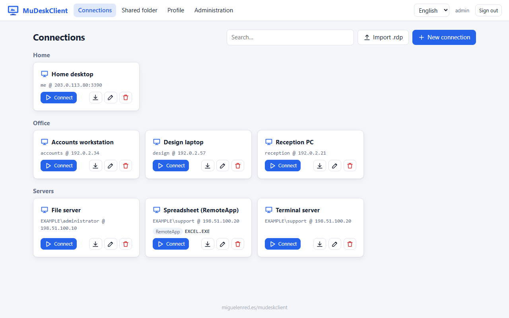
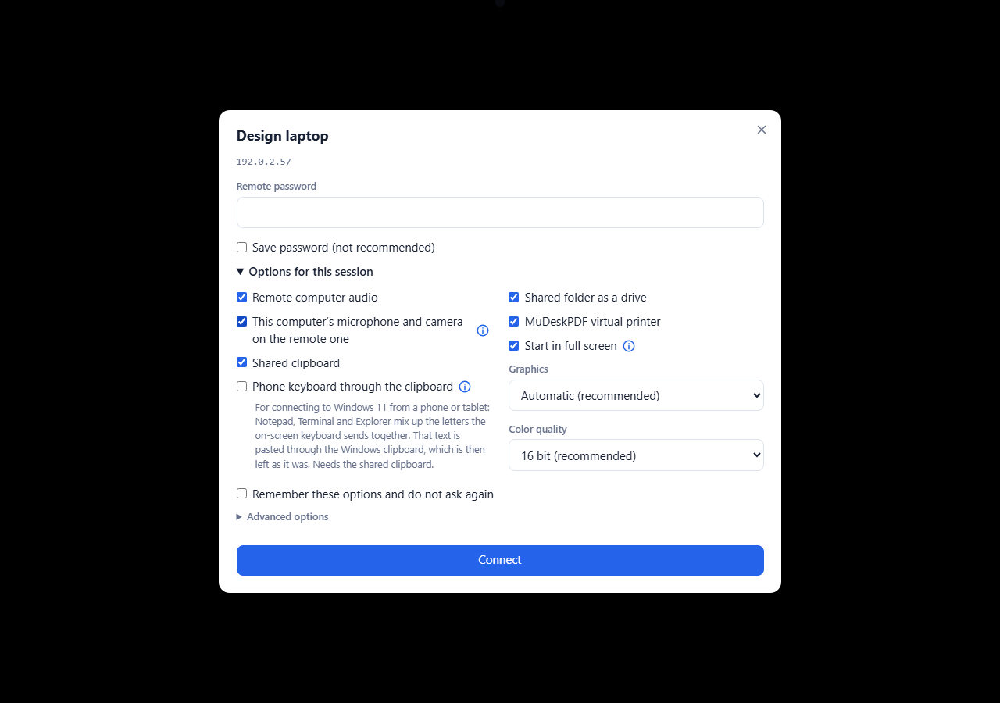
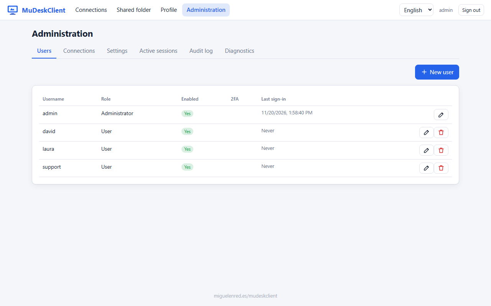
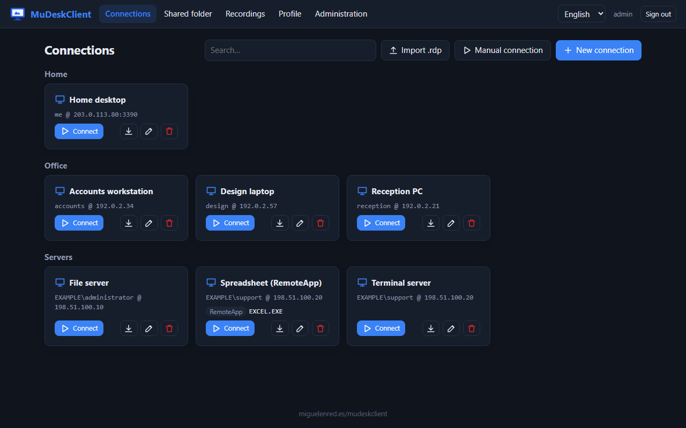

# MuDeskClient

Remote desktop (RDP) client that runs in the browser. The browser only uses HTML, CSS and JavaScript; a gateway written in plain PHP speaks RDP to the remote computers. Nothing has to be installed on the remote computers and no database is needed: all data is kept in JSON files.

[Leer en español](README.es.md)

## Screenshots



| Connecting: password and options | Administration | Dark mode |
|---|---|---|
|  |  |  |

Demo data: invented names and documentation addresses.

## Features

- Bulk compression (MPPC, NCRUSH, XCRUSH) end to end and drawing orders with the bitmap cache: both links carry compressed data.
- RDP with TLS and NLA (CredSSP with Kerberos or NTLMv2) and, for Windows XP and Server 2003, *Standard RDP Security*; RDS licensing, 15/16/24/32-bit color. User names as `user`, `DOMAIN\user`, `HOST\user`, `.\user` (local account of the server) or `user@domain` (UPN).
- Sign-in: users and administrator, optional TOTP and **passkeys** (passwordless, or a second step after the password: the device and browser decide, and MuDesk says which when adding one), one-time setup code, locks per IP / user / site that never lock the owner out of a known browser, constant-time answers. **Company accounts**: OpenID Connect (Microsoft Entra ID, Google, Keycloak…; a user who already has a password links it from their profile, see [how](docs/USAGE.md#linking-your-company-account-openid-connect)) and Windows accounts (Active Directory) checked against an RDP computer of the domain with NLA, without PHP extensions or LDAP (tested on a Windows Server 2022 domain, see [Testing](docs/TESTING.md)).
- Graphics in **automatic** mode (the default): with Windows 8.1 / Server 2012 R2 or later, detected when signing in, the graphics pipeline is used; with xrdp and older servers, bitmaps. RDPGFX graphics pipeline: AVC420 video decoded by the browser with WebCodecs, plus RemoteFX, RemoteFX progressive, ClearCodec, planar and the surface cache. When the browser cannot decode H.264 the other codecs are used. With H.264 the pipeline version 10.7 is offered too, the only one with which Windows 10/11 uses H.264 (in animated areas); AVC444 frames are shown from their 4:2:0 picture.
- Screen drawn on a `<canvas>`; keyboard (scancodes, any layout, dead keys, and Chinese, Japanese or Korean IME, which sends the text once confirmed), mouse, wheel and touch (tap, long press = right click, two-finger scroll; or, per connection, real **multitouch** to Windows 8 and later).
- The remote resolution follows the browser window (Display Control channel; reconnects with the new size when the server lacks it), or, per connection, the picture is scaled to the window (*Scale the picture*). Full-screen mode with keyboard capture where the browser allows it.
- Clipboard in both directions: text, formatted text (bold, colours… as HTML, the way Word and browsers copy it), images and files (download as ZIP when several files are copied remotely). Drag & drop files onto the session: they are pasted where they are dropped (on the desktop or in an open folder). Clipboard history like Win+V: what was copied either way, to paste it again on the remote computer.
- Screenshot of the remote desktop, whole or of an area framed with the mouse, saved as PNG or copied to the local or the remote clipboard.
- **MuDeskPDF** virtual printer: documents printed remotely arrive in the browser as PDF, ready to print on any local printer or to download.
- Remote audio (IMA ADPCM, A-law, μ-law or PCM, played with the Web Audio API) with a mute button.
- Microphone and camera (off by default, one box of the connection for both): the remote computer hears this computer's microphone while a program there records, and sees its camera (as “MuDesk camera”, Windows 10 1803 / Server 2019 and later) while a program there uses it, in Chrome, Edge and Firefox, the session saying so meanwhile (the remote Windows must allow audio recording redirection, and not forbid video capture redirection, see [HOSTING](docs/HOSTING.md#remote-computers); the page must be opened with `https://`).
- Connect dialog to choose audio, microphone and camera, clipboard, phone keyboard through the clipboard, shared folder, MuDeskPDF printer, graphics, colour depth, several screens and starting in full screen for each session (all can be remembered).
- Several screens: each local screen whose window is open is a separate remote monitor (not one stretched desktop); opening or closing that window adds or removes it without reconnecting. Chrome and Edge list the screens (Window Management API); Firefox looks for the other one by opening a window beside this one. *Start in full screen* (on by default) puts every screen in full screen: with the click on Connect where the browser allows it, else with a press in each window.
- Session toolbar that can be moved to a side (kept for the next sessions), with a quality indicator: frames per second, input latency and KB/s received. Its Files panel lists the files sent to the remote clipboard with their state and takes files dropped on it. The other screens' windows have a bar (full screen, close) and close with the session's window.
- **Sharing a session** with a link: whoever opens it watches the session without an account (view only, or using it too when the owner gives control, lost when not used), until the owner closes it, revokes the link or its time is over; how many watch is always in sight, and it is audited.
- **Administration status and backups**: sessions, processes, memory, disk and recent problems, charts of the last 30 days, `health.php` for a monitor; an encrypted backup of the installation, and its restore.
- **Session recording**: every session of a connection (set by the administrator), or from one moment to another with a button of the session (administrators; users when allowed) and from the active sessions; the user is told; the picture and the sound (the microphone's too), encrypted on the server, kept until deleted by hand (or the days of a setting); one of the connection made by the server from the session's stream, one started in the session made at once by the user's browser, of what it shows (a video: nothing stops); played in the browser by administrators and auditors, who can download them as WebM videos, and deleted by administrators; users watch, download and delete the ones they started, in **Recordings**.
- Phones and tablets: tap, long press = right click, pinch to zoom, two-finger pan/scroll, on-screen keyboard (opens by itself when tapping a text box; with a mouse, the button opens an on-screen keyboard of our own) and a special-keys panel (Esc, Tab, sticky Ctrl/Alt/Shift/Win, arrows, Home/End, PgUp/PgDn, Del, Backspace, Enter, F1–F12).
- Shared folder: each user's folder on the web server appears in the session as the **Shared folder on MuDesk** drive (in the language of the page); the web interface manages it as a file explorer (folder tree, details or icons with thumbnails, files and folders dragged in from the computer or between folders, several items or folders downloaded as one ZIP).
- A folder of this computer as a drive of the session: chosen in the session's *Files* panel while it runs (with the shared folder's option), it appears there by its name; Chrome and Edge read and write it, Firefox reads it only (it cannot write a folder of the computer). Its files go straight between the browser and the session; those read, written, deleted and renamed are audited.
- Users with an administrator role, optional two-step verification (TOTP, QR code), forced password change, brute-force lock-out.
- Profile: each user sees their open remote sessions and can end them, and their trusted browsers, which they can forget. At sign-in, the failed attempts with the user since the last sign-in are shown, if there were any.
- Installable as an app on phones and computers (web app manifest and icons, no service worker).
- Each user keeps their own connections; remote passwords are encrypted (AES-256-GCM) with a key derived from the user's password, so not even the administrator can read them. Connections are imported from and exported to **.rdp files** of Remote Desktop Connection (never their password), also by the administrator. A **manual connection** connects once without saving anything, for occasional ones. A connection can be a **RemoteApp**: one program of the remote computer, in its own windows over the page (also on several screens), with a taskbar and a list of its windows. With its MAC address, a computer that is off is turned on with **Wake-on-LAN** before connecting (installations on the computers' own network). It can also be the **console of a Hyper-V virtual machine** (its screen through the Hyper-V host, as VMConnect shows it; not yet tested against a real Hyper-V). Remote Desktop Services farms: through a **Remote Desktop Gateway** (MS-TSGU over HTTPS, in plain PHP; that of Windows Server 2008 and 2008 R2 too, with RPC over HTTP) and following a **connection broker**'s redirection (tested against Windows Server 2022's gateway, with its three transports, and its broker with one session host; not yet a redirection to another session host).
- Server certificates: the first connection to a computer shows its fingerprints to confirm before anything is sent (or one an administrator fixed for everyone); a change is warned of.
- Administration: users, connections for some users or all of them (they cannot change or delete them) and every user's own ones, allow-lists (client IPs and RDP targets: IPs, CIDR ranges, host names, `*.domain`), limits (also RDP sessions of all users at once), whether the password of RDP connections may be saved, active sessions (with forced termination), detailed audit log (sign-ins, changes, RDP sessions, clipboard, shared drive, printing) with search, export (CSV, or JSON signed with a server key that anyone can check with `openssl`), configurable retention (90 days by default, or unlimited) and tamper detection; diagnostic mode with a technical trace of a session (no contents or passwords).
- Spanish and English interface: the browser's language is used (English when it is neither), and each user can change it with the selector in the header (also on the sign-in screen and in the profile), which saves it in the profile; responsive, light and dark themes.

## Requirements

- PHP 8.1 to 8.5, 64-bit (all tested) with the bundled OpenSSL and session extensions only (no other extensions, no Composer packages).
- HTTPS (required by the browser clipboard API and by the login cookies).
- The web server must be able to keep one request open for the whole session and send its output without buffering (see *Hosting*).
- Outgoing TCP from the web server to the RDP port of the remote computers (3389 by default).
- A current browser (Chrome, Edge, Firefox) on desktop, tablet or phone. Safari has never been tested, and it cannot be here (no Apple device). Several screens: Chrome and Edge list them; Firefox looks for the other one (see *Limitations*).

## Compatibility (RDP and RDS)

**Important:** tested against Windows 11 Pro 23H2 (NLA), Windows Server 2022 (RD Session Host with RDS licensing, connection broker, RemoteApp, RD Gateway, Active Directory with Kerberos; see [TESTING](docs/TESTING.md#windows-server-2022-standard-after-120)), Windows Server 2012 R2, 2012, 2008 R2, 2008 and 2003 (see [TESTING](docs/TESTING.md)), xrdp 0.9.24 and the FreeRDP 3 server; the user also tried RemoteApp and a domain account (Active Directory, NTLMv2; with version 1.0) on a Windows Server 2016, and sound on Windows 10. Windows 10 and the other Windows Server versions speak the same RDP 10 as those tested, Windows 8.1 and 8 the same RDP 8.1 and 8.0 as Server 2012 R2 and 2012, Windows 7 the same RDP 7.1 as Server 2008 R2 and Windows Vista the same RDP 6.1 as Server 2008 (with its Service Pack 1); the rows of versions not tried are what the protocol specifications say.

| Server | Expected | Notes |
|---|---|---|
| Windows 11, 10, 8.1 (Pro/Enterprise) | Yes (tested Windows 11 Pro) | NLA or TLS. Tested on Windows 11: keyboard, mouse, resizing without reconnecting, MPPC/NCRUSH/XCRUSH compression, drawing orders, graphics pipeline with H.264, two monitors, clipboard (text, emoji and files), MuDesk drive, audio, microphone, camera (simulated), a folder of this computer. H.264 graphics need Windows 8.1 or later. |
| Windows Server 2025, 2022, 2019, 2016, 2012 R2 (Remote Desktop for administration or RD Session Host) | Yes (tested Windows Server 2022 and 2012 R2) | RD Session Host with RDS licensing (per-user mode recommended, see below). No sound or microphone until its Windows Audio service is started (see [HOSTING](docs/HOSTING.md#remote-computers)). Without the CredSSP update of May 2018 (2012 R2 as first released), NLA needs `credssp_unpatched`; no MuDeskPDF printer before 2016. |
| Windows 8, Server 2012 | Yes (tested Windows Server 2012) | *Automatic* graphics: drawing orders and bitmaps (the graphics pipeline 8.0, without H.264, when chosen by hand); dynamic resize reconnects. Without the CredSSP update of May 2018 (as first released), NLA needs `credssp_unpatched`; no MuDeskPDF printer. |
| Windows 7, Server 2008 R2 | Yes (tested Windows Server 2008 R2) | Only TLS 1.0 unless the TLS 1.2 update is installed (as first released, without secure renegotiation either: MuDeskClient's own TLS 1.0 reaches them); without the CredSSP update of May 2018, NLA needs `credssp_unpatched` (see below). No graphics pipeline, no dynamic resize without reconnecting, no MuDeskPDF printer; on Server 2008 R2 the sound needs Windows Audio started and *Audio and video playback* allowed (for the connections made after it). The RD Gateway of Server 2008 R2 (RPC over HTTP) can be used, with NTLM. |
| Windows Vista, Server 2008 | Yes (tested Windows Server 2008) | Same as above (tested with both of its Remote Desktop options), single monitor; Server 2008 gives 16 bits at most unless changed. |
| Windows XP, Server 2003 | Yes (tested Windows Server 2003) | *Standard RDP Security* (RC4 of 40, 56 or 128 bits, or FIPS triple DES), with the connection's security set to *Automatic* (tested on Server 2003, and against xrdp and the FreeRDP server). No NLA, no clipboard with files, no MuDeskPDF printer; 24 bits at most (Server 2003 limits it to 16 unless changed); its sound needs *Audio mapping* allowed in Terminal Services Configuration (for the sessions started after it). See [SECURITY](SECURITY.md). |
| xrdp 0.9 or later | Yes (tested) | TLS; without NLA. |
| FreeRDP server 3 | Yes (tested) | TLS/NLA, graphics pipeline with H.264. |

- **Protocol:** RDP core with client version 0x00080004 (RDP 5.0–8.1) over TLS 1.0–1.3, NLA (CredSSP v6, or the older version a server answers with, such as the 3 of Windows 7; with Kerberos (AES or RC4) or NTLMv2) or *Standard RDP Security* (RC4 of 40, 56 or 128 bits, or FIPS triple DES; only with the security *Automatic*; a server that encrypts nothing is refused); RDSTLS after a connection broker's redirection with a password encrypted for its server. Not supported: smart cards (a browser cannot let the gateway use the card's private key).
- **RDS:** the licensing exchange is supported (license request, platform challenge, new or upgraded license); licenses are not stored, so use **per-user** CAL mode (per-device mode was tried on Windows Server 2022 with its license server: a license is given at each connection, and as none is kept it may take a new temporary one each time). **RD Gateway**: the HTTP transport over a WebSocket (Windows Server 2016 and later) or over two HTTPS connections (2012, 2012 R2), signed in with Kerberos or NTLM (with the channel binding), and RPC over HTTP (2008, 2008 R2; NTLM only); not the UDP side channel. **Connection broker**: the load balance info as the routing token, and its redirections followed (Server Redirection PDU, at most 3; a password it encrypted for its server given there with RDSTLS). Tested against Windows Server 2022's gateway (its three transports) and its broker with one session host; not yet against older Windows Server gateways or a broker sending the session to another session host. Not supported: the graphics pipeline for **RemoteApp** programs (they use bitmaps and drawing orders).
- **Features by server version** (as specified): multi-monitor, Windows 7/2008 R2+; clipboard with files, Vista/2008+; dynamic resize (Display Control), 8.1/2012 R2+ (older ones reconnect with the new size); graphics pipeline, 8/2012+, H.264 (AVC420) 8.1/2012 R2+ (as specified: Windows takes H.264 only with the version 10 pipeline, Windows 10 / Server 2016 and later; Server 2012 R2 and Windows 11 chose 8.0 when offered 8.1); MuDeskPDF printer uses the *Microsoft Print To PDF* driver, present in Windows 10/Server 2016+; bulk compression MPPC every version, XCRUSH (RDP 6.1) Vista SP1/2008+; camera (MS-RDPECAM), Windows 10 1803/Server 2019+.

## Installation

Step by step for every level (a hosting, a Windows PC with XAMPP or a Linux computer with Apache, firewalls and common problems): **[installation manual](docs/INSTALL.md)**. In short:

1. Copy the project (or, with Composer, `composer create-project miguelenred/mudeskclient mudesk`: no dependencies, only PHP 8.1–8.5 with OpenSSL). Two layouts work (details in [HOSTING](docs/HOSTING.md)):
   - **Whole project inside the web root** (`public_html/mudesk/`): the bundled `.htaccess` files (Apache, LiteSpeed) and `web.config` files (IIS) leave only `public/` reachable; Nginx and OpenLiteSpeed need the rules in [HOSTING](docs/HOSTING.md) and deny `data/`, `src/`, `tests/`, `tools/` and `docs/`. Check that `mudesk/data/web-check.txt` answers 403 (or 404), never 200.
   - **Only `public/` in the web root** and the rest outside; if `public_html` is not inside the project folder, edit the `require` line at the top of `public_html/*.php` so it points to `src/bootstrap.php`.
2. Write permissions: **only `data/`** (and everything inside it) must be writable by the user PHP runs as; the application creates its subfolders (`audit/`, `connections/`, `files/`, `recordings/`, `run/`, `sessions/`, `tmp/`, `trace/`). Everything else (`public/`, `src/`, `config.php`) only needs to be readable. When `data/` is not writable, the application says so on a page of its own, with no PHP messages; on Windows (XAMPP, IIS) give the web server's account the *Modify* permission (see [HOSTING](docs/HOSTING.md#write-permissions)). Outside the project only PHP's own temporary folder (`upload_tmp_dir` in php.ini, or the system's one) must be writable, as it already is on hostings, XAMPP and Linux: PHP keeps there anything over 16 KB sent to the server (uploaded files, long pastes) while it arrives.
3. Optional: copy `config.sample.php` to `config.php` (in the project folder) and adjust it.
4. Open the site: the first visit asks for the **setup code**, found in `data/setup-code.php` (open it with the hosting file manager), and creates the administrator account. The code works only once, and for a day (then another one is written).

**To try it with Docker**, one command: `docker run -d --name mudesk -p 8443:443 -v mudesk-data:/var/www/mudesk/data ghcr.io/miguelenred/mudeskclient`, then open `https://localhost:8443`; or, in the project's folder, `docker compose up -d` with its `compose.yaml` (details in the [installation manual](docs/INSTALL.md#12-option-d-docker-to-try-it-or-on-a-server-with-docker)). Also a Helm chart for Kubernetes and a one-command LXC container for Proxmox VE ([sections 13 and 14](docs/INSTALL.md#13-option-e-kubernetes-helm)).

### Hosting

Each open session keeps one PHP request running and streams the screen through it. The first run checks the server step by step before the administrator is created (PHP, the data folder, HTTPS, a long request, PHP requests at once, a remote computer if you ask), each check with what to do when it is not right. To check a hosting before installing, upload `tools/check.php`, set its token and run its six tests (PHP environment, outgoing RDP connection, long request, latency, data folder reachable from the web, PHP processes at once). Remove it afterwards.

- Apache: `public/.htaccess` disables compression for the stream and has scripts and styles revalidated on every load (IIS: `public/web.config`), so an update reaches the browser at once. With PHP-FPM behind `mod_proxy_fcgi` add `flushpackets=on` to the proxy configuration.
- Nginx: disable buffering for `rdp.php` (`fastcgi_buffering off;`; the gateway also sends `X-Accel-Buffering: no`) and add `location ~* \.(js|css)$ { add_header Cache-Control "no-cache"; }`: the page asks for its script and style with a fingerprint of its files (`?v=`), but the modules they import carry none. A page left open during an update says so and offers to reload.
- Proxies such as Cloudflare close long requests (≈100 s); the client then reconnects automatically and the Windows session stays alive, but a direct connection is recommended.
- If the hosting forbids local Unix sockets set `'ipc' => 'file'` in `config.php`.
- Turn on OPcache (PHP's code cache): each short request of the keyboard, the mouse and the frame acknowledgements then takes PHP about 5 ms instead of 15 (measured on Windows with PHP's built-in server).
- Each open session counts as one PHP process, plus up to four short requests at a time while typing or moving the mouse (or while a remote program records from the microphone), and up to two more while one uses the camera or this computer's folder, or the session is recorded in the browser, plus one for each guest watching a shared session; check the hosting's process limit and keep *RDP sessions at once (all users)* (`max_sessions_total`, 20 by default) below it. When it is reached, the gateway says the server is busy, without connecting.
- On a server of your own (Linux: a VPS, the Docker image, the installer for Debian and Ubuntu) an optional WebSocket service of MuDeskClient's own carries the stream and the keyboard and mouse: less delay with them, no short requests while typing (fewer processes) and less CPU. The page tries it and uses it only when it answers, so without it everything works as always ([HOSTING](docs/HOSTING.md#websocket-optional)).

### Security notes

- Open the RDP port of the remote computers only to the IP address of the web server.
- Use NLA on the remote computers (default on current Windows versions).
- Self-signed server certificates are accepted: the first connection to a computer shows its fingerprints to compare before anything is sent, saves the one trusted and reports any later change. New connections come with the security *NLA only*: keep it, and let an administrator fix the fingerprints of the usual computers (see *Known limits* in [SECURITY](SECURITY.md)).
- `data/` holds the users, encrypted secrets and `secret.php` (server key); back it up. It can stay inside the web root: `.htaccess` files deny every folder but `public/`, and if the server ignores them nothing works until it applies them (every page says so; see [HOSTING](docs/HOSTING.md)).

## Configuration (`config.php`)

| Key | Default | Meaning |
|---|---|---|
| `data_dir` | `<project>/data` | Folder for JSON files, sessions, shared folders |
| `force_https` | `true` | Reject plain HTTP (localhost is always allowed, unless it is a trusted proxy) |
| `confirm_new_certificates` | `true` | The first connection to a computer (or gateway) never seen shows its fingerprints for the user to confirm before anything is sent; `false` trusts it at once, as before 1.2 |
| `credssp_unpatched` | `false` | NLA with a computer whose CredSSP lacks the May 2018 update (Windows 7 or Server 2008 R2 not updated) is refused, as Windows does (CVE-2018-0886); `true` allows it, only while that computer cannot be updated |
| `trusted_proxies` | `[]` | Reverse proxy IPs whose `X-Forwarded-For` / `X-Forwarded-Proto` are trusted: only the exact addresses of your own proxies, never a range (anything that is not an IP address stops the site with a page that says so) |
| `public_url` | none | The site's public address (where `index.php` is, for example `https://rdp.example.com/mudesk`): signing in with OpenID Connect and passkeys use it instead of each request's `Host` header (behind a proxy that does not pass the public name on) |
| `ipc` | `auto` | How running sessions are reached: `auto` (a Unix socket; on Windows a TCP port of this computer; the queue file if neither can be opened) or `file` (always the queue file) |
| `drawing_orders` | `true` | Let the server send copy/fill commands, text from cached glyphs and use the bitmap cache instead of resending bitmaps (≈3 times less traffic in the xrdp test; with Windows 11, dragging a window goes from 150 to 60 KB/s and PHP CPU from 6.5 to 2.7 %). Validated with xrdp and Windows 11: identical picture and no leftovers on repaint |
| `bulk_compression` | `'rdp61'` | Highest RDP bulk compression offered: `'rdp61'` (XCRUSH, Windows Vista SP1/2008+; servers that only know MPPC, such as xrdp, use MPPC), `'rdp6'` (NCRUSH), `'mppc'`, or `false`. Both links (RDP server → hosting → browser) carry compressed data: with MPPC ≈3.5 times less traffic, with XCRUSH about a third less than MPPC and less gateway CPU (see ARCHITECTURE) |
| `kerberos` | `true` | Kerberos tried before NTLM (NLA and the Remote Desktop Gateway); `false`: NTLM only |
| `kerberos_kdc` | `[]` | Domain controllers by realm, when the DNS does not give them: `['EMPRESA.LOCAL' => ['dc1.empresa.local', 'dc2.empresa.local:88']]` |
| `kerberos_dns` | `true` | Find them in the DNS (`_kerberos._tcp` SRV records); `false`: only those of `kerberos_kdc` |
| `record_max_mb` | `2048` | Largest size of one session recording, in MB; past it the rest of that session is not kept (the recording says so) |
| `websocket` | `true` | The optional WebSocket service (Linux, [HOSTING](docs/HOSTING.md#websocket-optional)) tried by the page; `false`: never tried, and the service ends at once |
| `websocket_listen` | `'127.0.0.1:8091'` | Where that service listens: the destination of the web server's proxy rule for `<public>/ws` |

The rest of the settings (allow-lists, lock-out, time-outs, session limits, reconnection attempts, quotas, 2FA policy, audit retention, diagnostic mode in every session, saving RDP passwords, days recordings are kept, users recording their own sessions) are edited by the administrator in the web interface.

## Limitations

- Graphics pipeline (RDPGFX): chosen by the automatic mode with Windows 8.1 or later (it can also be forced or turned off per connection; never used for RemoteApp). Tested against FreeRDP, Windows 11 and Windows Server 2022 (ClearCodec, RemoteFX progressive with upgrade passes; AVC420 with Windows 11). AVC444: its two pictures put back together in full colour where the browser gives a decoded picture's planes (Chrome, Edge), else its 4:2:0 picture; Windows 11 sent only that first picture in the tests, so the full colour is checked by the decoder's own tests. Without it, classic bitmap updates are used, which every Windows version supports.
- When typing from a phone through the clipboard, what was copied in Windows is put back except formats Windows does not hand over RDP (embedded Office OLE objects); when the text cannot be pasted (files copied in Windows, or more than 16 MB), at most 2000 characters are typed.
- Drawing orders: Mem3Blt is negotiated and drawn with its brush (checked against the protocol, not yet seen from a real server: with the graphics pipeline, as Windows 10 and 11 use it, drawing orders are not sent); a MemBlt whose blend mode uses a brush gets Windows' default white brush.
- The graphics pipeline keeps all its surfaces within 4 times the graphics output (at least 1920×1080; the output itself at most the pixels of 8192 × 8192, 32766 a side): a hostile RDP server can still make the browser hold up to about 1 GB; beyond that the browser fails with a logged error.
- **RemoteApp**: the remote computer must allow the program (Windows Server: published with Remote Desktop Services; Windows 10/11 Pro: in the `TSAppAllowList` registry key, see [HOSTING](docs/HOSTING.md#remote-computers)). Drawn with bitmaps and drawing orders (no graphics pipeline or H.264; the Graphics option is not offered); no icons in the Windows panel and no notification area. While it opens, a spinner says so (after 15 s, that it is taking longer); if the server ends the session meanwhile (error info 0x0B), the page connects again by itself; with no window after 90 s the session ends saying so. Closing its last window ends the session 3 s later.
- Phone keyboards on Windows 11: Notepad, Terminal and Explorer garble the text that comes from the on-screen keyboard (repeated letters, lost capitals or a lost Enter). It is a Windows bug, not a MuDeskClient one; details and tests in [Phone keyboards and Windows 11](docs/MOBILE-KEYBOARD.md). The "Phone keyboard through the clipboard" option (per connection; on "Automatic" it turns on by itself on phones and tablets) pastes that text through the remote clipboard and then puts the clipboard back as it was, an image copied in Windows included; when files had been copied in Windows the text is typed instead of pasted. An Enter followed by more text with no pause can still be lost in Notepad; at a phone's real pace it happened in 2 of 24 lines. The physical keyboard is not affected.
- Local printers are reached through the MuDeskPDF printer and the browser print dialog (browsers cannot see printers directly). No smart cards. The microphone goes as 16-bit PCM (the only format Windows 11 offers besides compressed ones: about 176 KB/s upwards while a program records); the camera as JPEG pictures (150–185 KB/s upwards at 640 × 480 measured with a simulated camera; a real one, an estimated 0.5–1.5 MB/s, while a program uses it).
- Kerberos and NTLM. Active Directory users sign in with Kerberos (as Windows does) when this server reaches a domain controller (found in the DNS, or given in `config.php`) and the domain is known by its DNS name: the domain `empresa.local`, `user@empresa.local`, or the computer by its full name; else with NTLMv2 (`DOMAIN\user`, or a computer by its address, as the computer a connection broker sends the session to without a gateway). Kerberos uses AES; RC4, for a Windows Server 2003 domain or an account whose password is older than its domain's AES keys, only if the administrator allows it (*Administration → Settings*, off by default: see [SECURITY](SECURITY.md); without it those accounts sign in with NTLM); a user@domain whose suffix is not its domain's (an alternate UPN suffix) is looked for through the KDC of the domain or of the computer, which names the domain that has it. A server in another domain of the forest, or one that refuses the ticket, is signed in to with NTLM; the sign-in to the domain controllers has 8 s in all (then NTLM). Passwords only: no smart cards. Where the domain blocks NTLM, or for members of *Protected Users*, Kerberos is needed. Domain accounts with NTLMv2 (`DOMAIN\user`) were tried by the user on a Windows Server 2016 of a domain, with version 1.0; Kerberos was tested against a Windows Server 2022 domain controller (see [TESTING](docs/TESTING.md)) and an MIT Kerberos test realm.
- Browsers cannot put files on the local clipboard: files copied on the remote computer are offered as a download.
- Reading the local clipboard automatically is only possible in Chromium-based browsers after granting permission; elsewhere use Ctrl+V or the clipboard panel.
- Several screens: Chrome and Edge list the screens (Window Management API). Firefox and Safari (never tested) do not: the other screen is looked for by opening a window next to the current one (pop-ups must be allowed), and two are used; when it is to the left of the main one, the first time that window has to be taken to it (see [USAGE](docs/USAGE.md#firefox-and-safari)).

## Project layout

```
public/            web root: index.php (interface), api.php, rdp.php (gateway), files.php, oidc.php, backup.php, health.php, assets/
src/               PHP classes (no dependencies)
src/Rdp/           RDP protocol: Client, Transport, CredSsp, Ntlm, Kerberos, RdpSecurity (XP, 2003), Gateway and GatewayRpc (RD Gateway), Licensing,
                   Cliprdr, Rdpdr, Rdpsnd, Drdynvc, Audin (microphone), Rdpecam (camera), Rail (RemoteApp), Rdpei (multitouch), Redirection (connection broker),
                   Bulk/Mppc/Ncrush/Xcrush (compression), Trace (diagnostics)
public/assets/     browser: rdpgfx.js (graphics pipeline), rfx.js (RemoteFX), gfxsurfaces.js, gfx.js, session.js, rdpfile.js (.rdp files),
                   mic.js and mic-worklet.js (microphone), camera.js and tick-worker.js (camera), localdrive.js (this computer's folder),
                   screen-watch.js (the other screens' windows)…
data/              JSON storage (created at runtime)
tools/check.php    hosting diagnostics
tools/ws-server.php the optional WebSocket service (Linux): each session a copy of it (pcntl), or tools/ws-session.php
Dockerfile, docker/ the Docker image (Apache, PHP 8.4, HTTPS); compose.yaml, to start it with Docker Compose
deploy/            the Helm chart for Kubernetes (helm/), the installer for Debian and Ubuntu (lxc/), the LXC container for Proxmox VE (proxmox/)
docs/              manuals (docs/es/: in Spanish) and the screenshots of this page (docs/images/)
tests/             unit tests and end-to-end tests
```

## Performance

The screen stream is read and decoded in a Web Worker, so input never waits for drawing. Keyboard and mouse events are sent at once (up to four requests in flight, re-ordered on the server by sequence number; one the hosting refuses is sent again) through a light endpoint that does not open the PHP session, and the RDP socket uses `TCP_NODELAY`. Measured: the gateway used 0.19 s of CPU and 4 MB of memory to relay 34 MB of full-screen changes in 14 s; with 60 ms of network latency the last key of fast typing arrives one round trip (≈65 ms) after it is pressed.

Bulk compression and the bitmap cache, against xrdp with the same 20 s of scrolling text and changing pictures (16-bit): 10.9 MB with plain bitmaps, 3.2 MB compressed, 3.9 MB with drawing orders and cache, **1.6 MB with both** (6.8 times less); gateway CPU 0.07 s, 0.50 s, 0.04 s and 0.30 s. The picture stays pixel-identical in Chrome and Firefox.

Against Windows 11 (details per codec and quality, PHP and browser apart, in [PERFORMANCE](docs/PERFORMANCE.md)): with the graphics pipeline PHP uses 0.4–2 % of a core per connection, against 6–52 % with compressed bitmaps; dragging a window costs 35 KB/s with the graphics pipeline, 60 KB/s with bitmaps and drawing orders and 150 KB/s with bitmaps alone. To size a server for the sessions you need at once (memory, CPU, processes) and raise its limits, see [HOSTING](docs/HOSTING.md#calculating-what-you-need).

With H.264 graphics, against a FreeRDP server and the same animated screen: 21 KB/s instead of 4.2 MB/s with 32-bit bitmaps (≈200 times less traffic); quality 33 dB PSNR in Chrome and Firefox. The browser acknowledges every decoded frame (only the latest one is sent), so the server adapts the frame rate to what the device can draw.

The speed review of 1.1 made the gateway's decompression 1.2 to 2.5 times faster (MPPC, NCRUSH, XCRUSH) and its RC4 1.35 to 1.86 times; the browser's decoders take 9 to 54 % less time, with the same pixels; on a slow computer (Edge held to a sixth of the CPU) an animation goes from 9.7 to 12.3 frames per second ([PERFORMANCE](docs/PERFORMANCE.md#fourth-review-11-decoders-delivery-to-the-page-and-slow-computers)).

## Tests

- `php tests/run.php` — protocol test vectors (NTLMv2, RC4, DER, TOTP, CIDR, UTF-16, Kerberos), audit, clipboard, error pages, file manager (move, tree, ZIP), web session expiry, RemoteApp (RAIL), the microphone and camera channels, a folder of this computer, the out-of-order lane, connections of the administrator, the page's file fingerprint, sharing and recording; Standard RDP Security, NLA with Kerberos, the RD Gateway (its three transports) and the connection broker against test servers written from the specifications (`tests/fixtures/`).
- `php tests/auth_e2e.php base dataDir` — sign-in security against a running copy with an empty data folder.
- `php tests/rdp_probe.php host port user password` — connects from the command line and reports what the browser would receive.
- `node tests/bench.mjs host port user password [workload] [seconds]` — measures one connection under a workload (idle, text, window drag, animation, sound): traffic, PHP CPU and memory, CPU and memory of the browser decoders, frames per second (see [Performance](docs/PERFORMANCE.md)).
- `node tests/input_unit.mjs` — typed text (one character at a time) and the text cursor that opens the phone keyboard.
- `node tests/clipboard_unit.mjs` — formatted text (CF_HTML) for the clipboard.
- `node tests/rdpfile_unit.mjs` — .rdp files of Remote Desktop Connection: read into a connection and written from one.
- `node tests/mic_unit.mjs` — the microphone in the browser: resampling and 16-bit PCM, its capture and when it is let go.
- `node tests/camera_unit.mjs` — the camera in the browser: whether there is one, the size and rate asked for, each picture a JPEG, refusals and when it is let go.
- `node tests/localdrive_unit.mjs` — a folder of this computer: the server's requests answered on File System Access (read and write) and on a folder's files (read only).
- `tests/gfx_unit.mjs`, `tests/rdpgfx_unit.mjs` (ZGFX, ClearCodec, NSCodec, RemoteFX, progressive, H.264 SPS), `tests/bulk_unit.mjs` (MPPC, NCRUSH, XCRUSH, fragments), `tests/orders_unit.mjs` (also windowing orders), `tests/audio_codecs.mjs` (needs sox) — decoder unit tests (Node.js).
- `node tests/session_unit.mjs` (input, reconnection, drawing orders, stream worker, several screens, RemoteApp, the camera and this computer's folder on the out-of-order lane), `node tests/ui_unit.mjs` (profile, audit, session window, ZIP downloads, screenshot, file explorer, session expired, .rdp files, connections of the administrator, RemoteApp, Files panel, movable toolbar, update notice, the other screens' windows) — browser code on minimal doubles.
- `php tests/fuzz.php`, `node tests/fuzz.mjs` — random and mutated data against the gateway (RDP core and channels, RemoteApp, the microphone and the camera too, this computer's folder, Standard RDP Security, Kerberos and the RPC transport of the RD Gateway) and the browser decoders; fixed seed, options `--seed`, `--iterations`, `--target`, `--case` and `--strict`.
- `tests/gfx_render.mjs`, `tests/audio_check.mjs` — decode dumps written by `rdp_probe.php` (`DUMP=file`, `AUDIO=1`).
- `tests/e2e.mjs`, `tests/e2e_clip.mjs`, `tests/e2e_gfx.mjs` (H.264: compares the canvas with a capture of the remote), `tests/e2e_passkey.mjs`, `tests/e2e_lang.mjs`, `tests/e2e_glyphs.mjs` — Chrome tests (Node.js + Playwright); `tests/e2e_firefox.py` — Firefox tests (Selenium). Development only.

On GitHub every push runs `tests/run.php` and `tests/fuzz.php` on Linux and Windows with PHP 8.1, 8.2, 8.3, 8.4 and 8.5 (any warning, notice or deprecation fails the run), and every `tests/*_unit.mjs` and `tests/fuzz.mjs` with the current and the previous Node.js LTS.

## Documentation

- [Installation manual (every level)](docs/INSTALL.md)
- [User guide](docs/USAGE.md)
- [Hosting and deployment](docs/HOSTING.md)
- [How it works, in brief](docs/ARCHITECTURE.md#in-brief-how-it-works) · [Architecture and security model](docs/ARCHITECTURE.md)
- [Testing and results](docs/TESTING.md) · [Known vulnerabilities of RDP clients, checked](docs/VULNERABILITIES.md)
- [Performance: bandwidth, CPU and memory per codec](docs/PERFORMANCE.md)
- [Phone keyboards and Windows 11](docs/MOBILE-KEYBOARD.md)
- [Roadmap and design decisions](docs/ROADMAP.md)
- [Changelog](CHANGELOG.md) · [Security policy](SECURITY.md) · [Contributing](CONTRIBUTING.md)

## Authorship and way of working

**Miguel Sánchez** ([miguelenred.es/mudeskclient](https://miguelenred.es/mudeskclient)) is the author of MuDeskClient:

- the idea of the project is his;
- he organizes the work: what is built, and in which order;
- he sets the way of working: security first, performance measured before and after every change, a test that fails without each critical change, documentation kept up to date in English and Spanish, and honesty about what is tested and what is not.

He is assisted by artificial intelligence, which writes code, tests and documentation following his directions; he reviews the results, tries them on real computers and decides what goes in.

For transparency, what is tested, how it was tested and what is **not** tested yet are listed in [Testing](docs/TESTING.md); known limitations are above and in the [roadmap](docs/ROADMAP.md).

## Disclaimer

MuDeskClient is made as well as we know how and as well as we can: security first, a test for every critical change, and the code checked against the known vulnerabilities of RDP clients and reviewed in code audits. When we find a fault or a bug, we try to fix it and publish an update as soon as we can (to report one, see [SECURITY](SECURITY.md)).

Even so, no software is free of faults. MuDeskClient is provided "as is", without warranties of any kind, and its authors accept no liability for any damage, including when a malicious user or an attacker manages to compromise the application, the server it runs on, the remote computers or the data, as sections 7 and 8 of the [Apache License 2.0](LICENSE) say. Whoever installs it is responsible for keeping it updated, setting it up as [SECURITY](SECURITY.md) recommends and backing up its data.

## License

MuDeskClient is free software under the **Apache License 2.0**: it can be used, changed and redistributed, also commercially, under its conditions (keep the license and the NOTICE file, and say what you changed). See [LICENSE](LICENSE) and [NOTICE](NOTICE).

It is not required, but if you use it, a **"Powered by MuDeskClient"** mention (with a link to https://miguelenred.es/mudeskclient) is appreciated.
